<picture>
  <source media="(prefers-color-scheme: dark)" srcset="./assets/header-dark.svg">
  
</picture>

 

I take things apart to see how they work, then build small tools that do one job well.
Mostly around **reverse engineering**, **networking**, and the odd **iOS / Android** hack.

在逆向、网络和小工具之间慢慢打磨。

 

**Now**

- Tinkering with jailbreak tooling for iOS 17 (roothide)
- Running self-hosted services on Cloudflare Workers
- Writing occasionally on my blog

**Selected work**

| | |
|:--|:--|
| [**TrollStore-roothide**](https://github.com/lansonsam/TrollStore-roothide) | TrollStore Lite build for roothide jailbreaks on iOS 17 |
| [**anylink**](https://github.com/lansonsam/anylink) | SSL VPN server compatible with AnyConnect clients |
| [**fuwari**](https://github.com/lansonsam/fuwari) | My personal blog, built on Astro |

**Toolbox**

`Python` `Go` `TypeScript` `Kotlin` `C++` `C#` `Vue` &nbsp;·&nbsp; `Cloudflare` `Linux` `Android` `iOS`

 

<picture>
  <source media="(prefers-color-scheme: dark)" srcset="https://raw.githubusercontent.com/lansonsam/lansonsam/output/snake-gray-dark.svg">
  
</picture>

 

[Steam](https://steamcommunity.com/profiles/76561198862773271) &nbsp;·&nbsp; thanks for stopping by.
